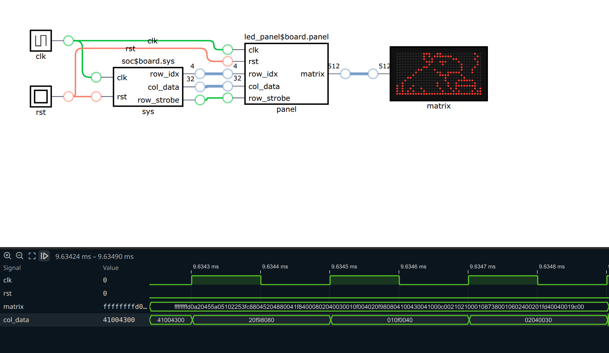
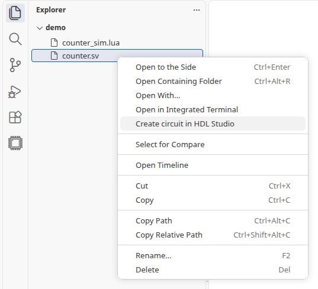
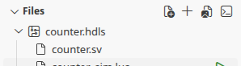
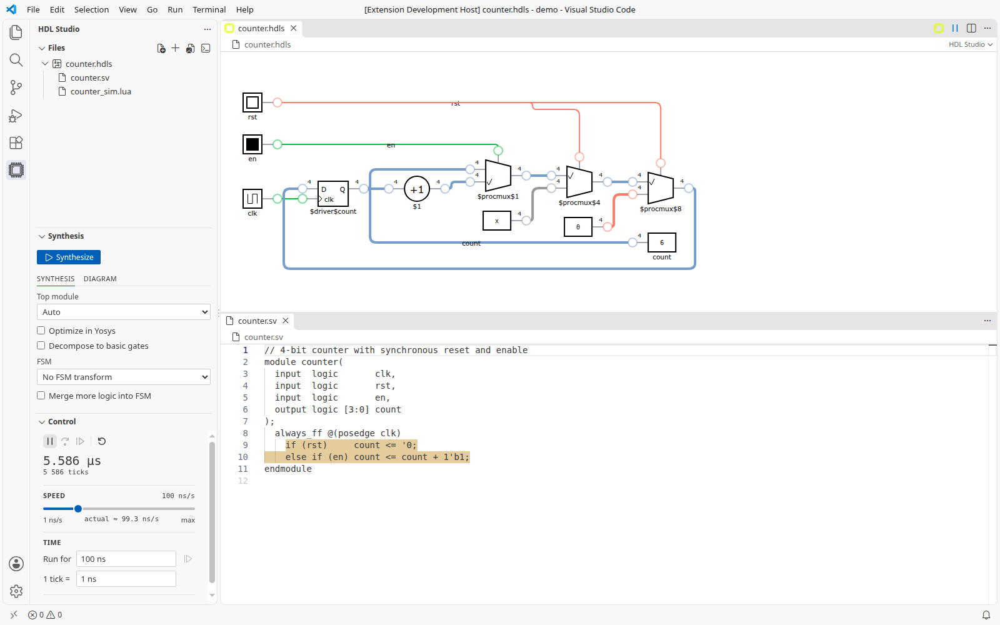
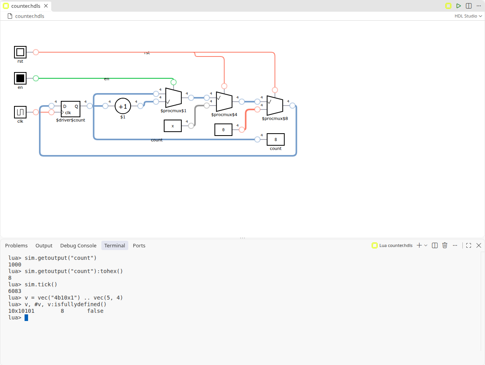

# HDL Studio

[](https://marketplace.visualstudio.com/items?itemName=TwinT.hdl-studio)

**Write Verilog/SystemVerilog, see the circuit, and watch it run — inside VS Code.**

HDL Studio synthesizes your sources with [Yosys](https://yosyshq.net/yosys/), draws the
result as an interactive schematic and simulates that same circuit gate by gate: 4-valued
logic (0, 1, x, z), tri-state buses and per-cell delays. Flip switches, press buttons, read
7-segment displays and LED matrices, follow any wire in a waveform monitor, or drive the
whole thing from a Lua script. It was made for teaching digital design, so what you see is
what the synthesizer actually built.



- [Requirements](#requirements)
- [Quick start](#quick-start)
- [Features](#features)
- [Using HDL Studio](#using-hdl-studio)
- [I/O widgets](#io-widgets)
- [Lua scripting](#lua-scripting)
- [Settings](#settings)
- [Troubleshooting](#troubleshooting)
- [Development](#development)
- [Credits](#credits)

## Requirements

- **Yosys** on the `PATH` (or set `hdl-studio.yosysPath`). With the
  [yosys-slang](https://github.com/povik/yosys-slang) plugin HDL Studio uses it
  automatically and gets full SystemVerilog (packages, interfaces, any file order);
  without it, Yosys's own `read_verilog -sv` is used.
  The [`twint/sd`](https://hub.docker.com/r/twint/sd) dev container has both; see
  [hdl_studio_test](https://github.com/TwinT/hdl_studio_test) for a ready-made setup.
- **Linux x64.** The simulator is a native binary shipped inside the extension, so
  HDL Studio does not run in the browser (vscode.dev).

## Quick start

1. Open a `.sv` (or `.v`) file, e.g. this counter:

   ```systemverilog
   module counter(input logic clk, input logic rst, output logic [3:0] count);
     always_ff @(posedge clk)
       if (rst) count <= '0;
       else     count <= count + 1'b1;
   endmodule
   ```

2. Click the HDL Studio icon in the editor title bar (or right-click the file in the
   Explorer → **Create circuit in HDL Studio**). A new project is created with the file
   in it.
3. Press **Synthesize** in the *Synthesis* panel. The schematic appears; `clk` became a
   clock, `rst` a switch and `count` a number display.
4. Press **Start** (▶ in the editor title or the *Control* panel). Click `rst` to toggle
   it and watch `count` go.
5. Double-click the `count` wire to add it to the waveform monitor.
6. Save (`Ctrl+S`): the project is a `.hdls` file next to your sources.

More examples, each with a Lua test script, are in
[`test/verilog/`](./test/verilog/): latches, adders, an LFSR, RAM/ROM, a BCD to
7-segment decoder, an LED matrix, a tri-state bus, and a small RISC-V CPU
([`micro`](./test/verilog/micro/), [`soc`](./test/verilog/soc/rtl/)).

## Features

- **Interactive schematic** of the synthesized netlist, laid out automatically; drag
  cells to rearrange it (the layout is saved). Subcircuits, memories (with a hex editor)
  and FSMs (as a state diagram) open in their own windows.
- **Gate-level simulation** with 4-valued logic, tri-state buses and per-cell delays:
  run continuously at an adjustable speed (or flat out), one tick, one clock cycle, or
  a given time (`2 us`), and reset to tick 0.
- **Waveform monitor** for any wire, with number formats and *pause when* conditions
  (rises, falls, changes, becomes x, equals a value).
- **I/O widgets** inferred from the top module's ports: clocks, switches, push buttons,
  number fields, lamps, number displays, 7-segment displays and LED matrices.
- **Source highlighting**: hover a cell or a wire to see the lines of code it came from.
- **Lua 5.4 scripting** and a Lua terminal to drive and check the simulation.
- **Undo/redo** of everything, from re-synthesis to moving a cell.
- **Image export** to SVG, PNG or JPEG, signal levels included.
- Several circuits open and simulating at once; mouse, trackpad and touch navigation.

## Using HDL Studio

### Projects and files

A project (`.hdls`, JSON) holds the source files' relative paths, the synthesis options,
the synthesized circuit and its layout. To move it to another machine, copy the sources
along with it, keeping the same relative paths.

- **New project:** *HDL Studio: New Circuit*, or the HDL Studio icon in the editor title
  when the current file isn't part of a project.
- **From existing sources** (`.v`, `.sv`, `.vh`, `.lua`): the HDL Studio icon on an open
  file, or *Create circuit in HDL Studio* in the Explorer's context menu (the
  *Recursive* variant takes a whole folder). The project takes the file's name.

  

- **Adding files:** the same icon and context menu (*Add to HDL Studio*), or *Add Files*
  in the *Files* panel.

  

- **Other formats:** projects from before 1.0 (`.digitaljs`) open as they are (*Save As*
  gives them the new extension). A `.json` file — a circuit from
  [DigitalJS Online](https://digitaljs.tilk.eu/) or a raw Yosys JSON netlist — opens with
  *Open as circuit in HDL Studio* or *Open With*. Without sources you can simulate but
  not re-synthesize.

The HDL Studio side bar has three panels: **Files** (the project's sources and Lua
scripts), **Synthesis** (options and the Synthesize button) and **Control** (run controls
and the top module's inputs and outputs).

### Synthesis

Press **Synthesize** in the *Synthesis* panel. Its options are saved with the project:

| Option | What it does |
|---|---|
| Top module | The top of the design (*Auto* lets Yosys pick it). |
| Optimize in Yosys | `opt -full`. The circuit may differ a lot from the source. |
| Decompose to basic gates | `techmap`: adders, comparators, muxes… become basic gates (flip-flops and memories are kept). |
| FSM | *FSM transform* (`fsm`) or *FSM as circuit element* (`fsm -nomap`, an FSM cell with a state diagram). |
| Merge more logic into FSM | `fsm_expand`. |
| Simplify diagram | Post-process the netlist into fewer cells, easier to read. On by default. |
| Zero combinational propagation delay | A combinational path settles in one tick instead of one tick per gate. |

Yosys's script and output go to the *HDL Studio (Yosys)* output channel.

With the source open beside the schematic, hovering a cell or wire highlights the code
that produced it:



### The schematic

- **Navigate:** drag the background or scroll to pan; `Ctrl` + wheel or pinch to zoom;
  double-click the background to zoom in.
- **Rearrange:** drag cells; their wires reroute around other cells. Moving is an edit
  (undoable, saved) and doesn't restart the simulation.
- **Open:** subcircuits, memories and FSMs show a magnifying glass on hover — click it or
  double-click the cell.
- **Read values:** hover a wire. Wires are coloured by value:

  | Colour | Value |
  |---|---|
  | green | all ones |
  | salmon | all zeros |
  | blue | a defined mix of 0s and 1s |
  | orange | high impedance (z) |
  | grey | undefined (x) |

### Simulation

Start and pause with ▶/⏸ in the editor title or the *Control* panel, which also has:

- **Step** — one tick.
- **One clock cycle** — one period of the first clock; it stops at the same phase, with
  everything settled.
- **Run for** — a given time (`100 ns`, `2 us`…), then pause.
- **Reset** — back to tick 0, registers and memories at their initial values. The layout,
  open windows and watched signals stay.
- **Speed** — how fast *Start* runs, in ticks per second, up to *max* (as fast as
  possible). The panel shows the speed actually reached; a big circuit may not keep up.
- **Timescale** — how long a tick is (`1 tick = 1 ns` by default), per project. Times and
  clock periods in the panel are shown and entered in these units.

Change inputs on the schematic (click a switch, hold a push button, type into or scroll
over a number field) or in the *Control* panel, which also shows the outputs.

### Waveforms

Hover a wire and click its waveform button, or double-click the wire, to add it to the
monitor under the schematic.

- Values are shown under the pointer (otherwise at the right edge), with a ruler in the
  project's time units.
- Click the waveforms to stop following the simulation and look around; click again to
  follow it. Drag to scroll, `Ctrl` + wheel to zoom.
- Right-click a signal (or its `…` button) to change its number format, remove it, or
  **pause the simulation** when it rises, falls, changes, becomes x or equals a value.
  Press *Start*: the simulation runs until that happens, and the monitor marks the moment
  and says why it paused.

### Saving, undo and export

The circuit view is a regular VS Code editor: save, *Save As*, revert, undo and redo all
work, and undo covers re-synthesis and layout changes. Simulation state isn't saved.
*Save As* reopens the project under its new name, which restarts the simulation.

*Export Circuit As Image* saves the open view (with its signal levels) as SVG, PNG or
JPEG. Subcircuit windows are exported one at a time, while open.

## I/O widgets

The top module's ports become widgets on the schematic and in the *Control* panel,
chosen by name and width:

| Port | Widget |
|---|---|
| 1-bit input named `clk` or `clock` | Clock (period editable in the *Control* panel) |
| 1-bit input named `pushbutton*`, or marked `(* momentary *)` | Push button (high only while held) |
| any other 1-bit input | Switch (click toggles) |
| multi-bit input | Number field |
| 1-bit output | Lamp |
| 8-bit output named `display7` or `display7_*` | 7-segment display |
| output with `(* led_matrix_rows = R, led_matrix_cols = C *)`, width `R*C` | LED matrix |
| any other multi-bit output | Number display |

```systemverilog
module panel(
  input  logic clk,                       // Clock
  (* momentary *) input logic fire,       // Push button
  input  logic [7:0] speed,               // Number field
  output logic [7:0] display7_units,      // 7-segment display
  (* led_matrix_rows = 4, led_matrix_cols = 8 *)
  output logic [31:0] leds                // 4×8 LED matrix
);
```

In an LED matrix, bit `r*C + c` is row `r`, column `c` (bit 0 is top-left). See
[`10_led_matrix`](./test/verilog/10_led_matrix/) and
[`09_bcd_to_7seg`](./test/verilog/09_bcd_to_7seg/).

## Lua scripting

Add a `.lua` file to the project and press its ▶ in the *Files* panel (it becomes ■ to
stop it). Running a script starts the simulation; the simulation pauses when it ends.
Only one script runs at a time.

```lua
-- Reset the counter, then print it on 20 rising clock edges.
sim.setinput("rst", true)
sim.wait(sim.posedge("clk"))
sim.setinput("rst", false)

for i = 1, 20 do
  sim.wait(sim.posedge("clk"))
  print(string.format("cycle %2d: count = %s", i, sim.getoutput("count"):tohex()))
end
```

The **Lua terminal** (*Show Lua Terminal* in the *Files* panel) runs Lua interactively,
with line editing and history, and prints the value of an expression. While it's open,
scripts print to it instead of to notifications. `Ctrl+C` aborts the command being typed
in, not other scripts.



### `sim`: the circuit

Names are as in the sources. A wire inside a subcircuit is named by the instance path
first: `sim.getvalue("core_i", "pc")`.

| Function | Does |
|---|---|
| `sim.setinput(name, value)` | Set a top-level input. |
| `sim.getoutput(name)` | Read a top-level output (a `vec`). |
| `sim.getvalue(..., wire)` | Read any named wire. |
| `sim.tick()` | The current tick. |
| `sim.sleep(n)` | Wait `n` ticks. |
| `sim.wait(event[, n])` | Wait for an event, at most `n` ticks. |
| `sim.posedge(..., wire)`, `sim.negedge(..., wire)` | Event: the wire rises / falls. |
| `sim.value(v, ..., wire)` | Event: the wire takes value `v`. |
| `e1 \| e2` | Event: whichever happens first. |

Values given to `sim` can be vecs, booleans, integers or strings like `"8hff"`.
`print` shows its arguments.

### `vec`: 4-valued vectors

| | |
|---|---|
| Make | `vec(5)`, `vec(-3, 8)`, `vec(true)`, `vec("8ha5")`, `vec("4b1x0z")`, `vec.frombin("1x0z")`, `vec.fromhex("f0", 12)`, `vec.fromoct(s[, bits])`, `vec.frombool(b[, bits])`, `vec.frominteger(n[, bits])` |
| Read | `v:tobin()`, `v:tohex()`, `v:tooct()`, `v:tointeger()`, `v:tointegersigned()` (up to 63 bits), `#v` (width), `v(i)` (bit `i`, negative counts from the top), `v(i, n)` (`n` bits from `i`) |
| Operators | `&`, `\|`, `~` (xor), `~v` (not), `==`, `a .. b` (concatenation, `a` on top as in `{a, b}`) |
| Bitwise | `band bor bxor bnand bnor bxnor bnot` |
| Reductions | `rand ror rxor rnand rnor rxnor` |
| Tests | `ishigh islow isdefined isfullydefined`, `xmask` |

## Settings

| Setting | Default | |
|---|---|---|
| `hdl-studio.yosysPath` | `""` (use `PATH`) | Path to the `yosys` executable. |
| `hdl-studio.waveform.colors` | [Surfer](https://surfer-project.org)'s dark theme | Waveform colours as CSS colours: `background`, `altBackground`, `foreground`, `grid`, `signal`, `undefined`, `highImpedance`, `cursor`, `fillOpacity`. Any key can be left out. |

The simulation speed is global and remembered between sessions.

## Troubleshooting

- **Nothing happens on Synthesize / "yosys not found".** Check that `yosys` runs in a
  terminal, or set `hdl-studio.yosysPath`. Yosys's errors are in the *HDL Studio (Yosys)*
  output channel.
- **SystemVerilog constructs are rejected** (packages, interfaces, `import`). Install the
  yosys-slang plugin; plain `read_verilog -sv` supports only part of SystemVerilog.
- **`$readmemh` can't find its file.** Add the data file to the project; a bare file name
  (`"memory.hex"`) is found even if the file is in a subfolder.
- **A huge or slow netlist.** Size indices with `$clog2(N)` instead of using `int`:
  Yosys keeps an index's full width, which turns `mem[i]` into 32-bit logic.
- **A circuit doesn't do anything for a while.** Some take thousands of cycles to show
  something (the `soc` board needs ~1500 after reset); set the speed to *max*.

## Development

```sh
npm install
npm run compile   # engine (cargo build --release) + webview and host bundles
npm test          # Rust, pipeline (needs yosys), golden traces, schematic (Playwright), VS Code
npm run lint
```

Press `F5` in VS Code to launch an Extension Development Host; after rebuilding, run
*Developer: Reload Window* there. The simulator, converter and Lua engine are the Rust
workspace in [`crates/`](./crates/) (`hdlstudio`, a native process per circuit view);
the schematic is TypeScript in [`view/`](./view/); the extension host is
[`src/`](./src/). Packaging (`vsce package`) produces a per-platform `.vsix`.

Contributions are welcome — open an issue or a pull request.

## Credits

HDL Studio is a fork of [digitaljs_code](https://github.com/yuyichao/digitaljs_code) by
[Yichao Yu](https://github.com/yuyichao), maintained with a focus on classroom use. It was
built on [DigitalJS](https://github.com/tilk/digitaljs),
[yosys2digitaljs](https://github.com/tilk/yosys2digitaljs) and
[digitaljs_lua](https://github.com/tilk/digitaljs_lua) by
[Marek Materzok](http://www.tilk.eu/) at the
[University of Wrocław](http://www.ii.uni.wroc.pl/). Version 1.0 replaces them with its own
simulator, converter and Lua engine, which keep their semantics and file format: projects
from earlier versions and circuits from [DigitalJS Online](https://digitaljs.tilk.eu/)
open as they are. Third-party notices are in [NOTICE](./NOTICE).

## License

BSD 2-Clause. See [LICENSE](./LICENSE).
