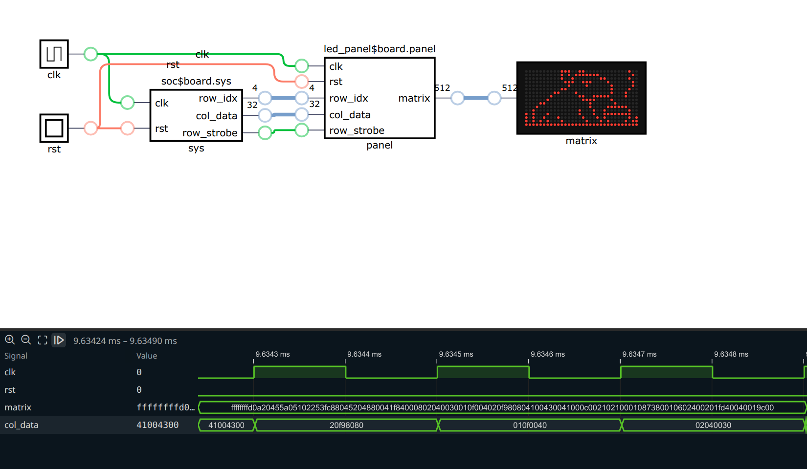
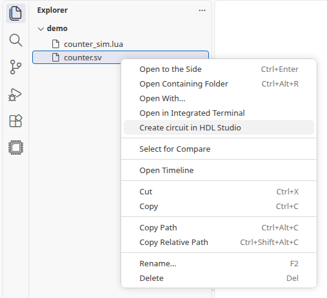
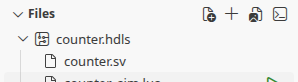
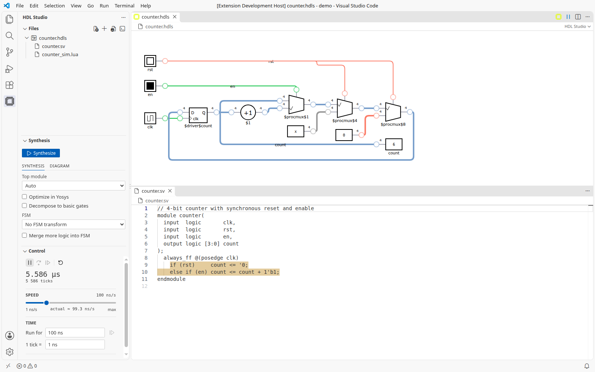
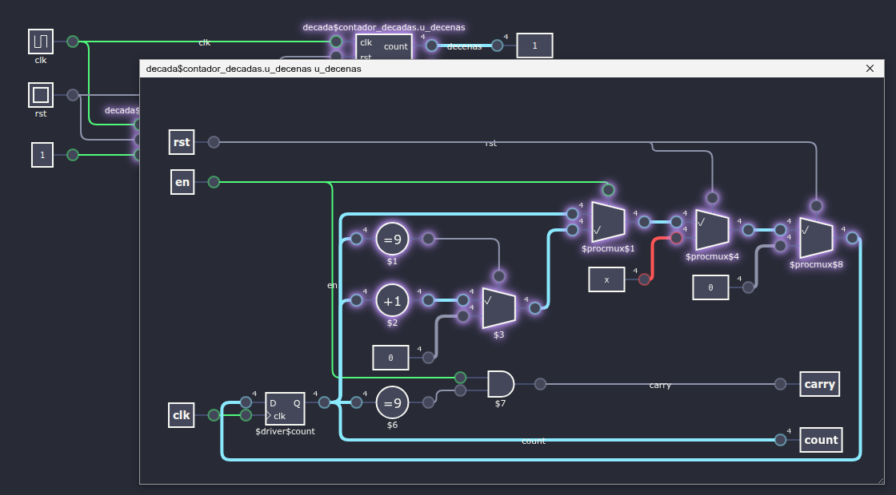
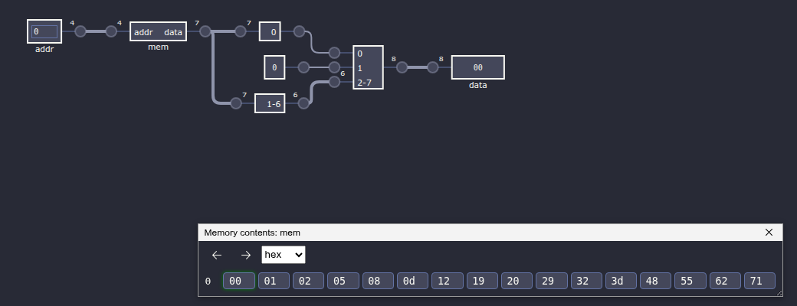
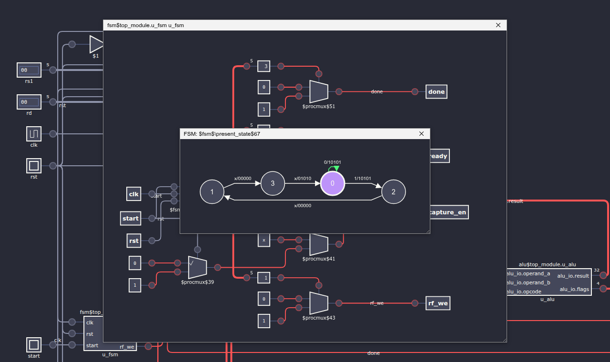
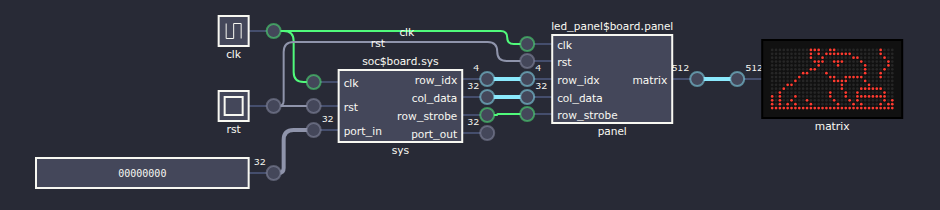
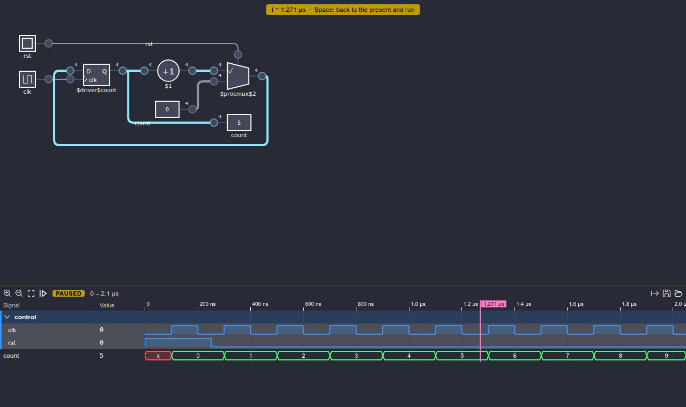
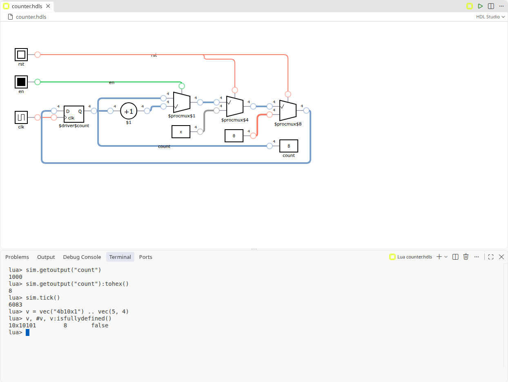

# HDL Studio

[](https://marketplace.visualstudio.com/items?itemName=TwinT.hdl-studio)
[](https://open-vsx.org/extension/TwinT/hdl-studio)

**Write Verilog/SystemVerilog, see the circuit, and watch it run — inside VS Code.**

HDL Studio synthesizes your sources with [Yosys](https://yosyshq.net/yosys/), draws the
result as an interactive schematic and simulates that same circuit gate by gate: 4-valued
logic (0, 1, x, z), tri-state buses and per-cell delays. Flip switches, press buttons (on
screen or from the keyboard), read 7-segment displays and LED matrices, follow any wire in
a waveform monitor, travel back in time, or drive and test the whole thing from Lua. It
was made for teaching digital design, so what you see is what the synthesizer actually
built.



## Contents

- [Requirements](#requirements)
- [Quick start](#quick-start)
- [Features at a glance](#features-at-a-glance)
- [User guide](#user-guide)
  - [Projects and files](#projects-and-files)
  - [Synthesis](#synthesis)
  - [Errors and warnings](#errors-and-warnings)
  - [From the code to the circuit and back](#from-the-code-to-the-circuit-and-back)
  - [The schematic](#the-schematic)
  - [Subcircuits, memories and FSMs](#subcircuits-memories-and-fsms)
  - [Inputs and outputs](#inputs-and-outputs)
  - [Simulation](#simulation)
  - [Waveforms](#waveforms)
  - [Lua scripts and the Lua terminal](#lua-scripts-and-the-lua-terminal)
  - [Lua tests](#lua-tests)
  - [Saving, undo and export](#saving-undo-and-export)
- [Keyboard and mouse](#keyboard-and-mouse)
- [Settings](#settings)
- [Commands](#commands)
- [Examples](#examples)
- [Command line](#command-line)
- [Troubleshooting](#troubleshooting)
- [Development](#development)
- [Credits](#credits)

## Requirements

- **Yosys** on the `PATH` (or set `hdl-studio.yosysPath`). With
  [yosys-slang](https://github.com/povik/yosys-slang), built in or as the `slang` plugin
  (the [OSS CAD Suite](https://github.com/YosysHQ/oss-cad-suite-build) has it), HDL
  Studio uses it automatically and gets full SystemVerilog (packages, interfaces, any
  file order); without it, Yosys's own `read_verilog -sv` is used.
  The [`twint/sd`](https://hub.docker.com/r/twint/sd) dev container has both; see
  [hdl_studio_test](https://github.com/TwinT/hdl_studio_test) for a ready-made setup.
- **Linux x64** (glibc 2.34 or newer: Ubuntu 22.04, Debian 12...), **Windows x64** or
  **macOS on Apple silicon**. The simulator is a native binary shipped inside the
  extension, one package per platform, so HDL Studio does not run in the browser
  (vscode.dev).

## Quick start

1. Open a `.sv` (or `.v`) file, e.g. this counter:

   ```systemverilog
   module counter(input logic clk, input logic rst, output logic [3:0] count);
     always_ff @(posedge clk)
       if (rst) count <= '0;
       else     count <= count + 1'b1;
   endmodule
   ```

2. Click the HDL Studio icon in the editor title bar (or right-click the file in the
   Explorer → **Create circuit in HDL Studio**). A new project is created with the file
   in it.
3. Press **Synthesize** in the *Synthesis* panel. The schematic appears; `clk` became a
   clock, `rst` a switch and `count` a number display. A mistake in the code shows up
   in the *Problems* panel, underlined where it is.
4. Press **Start** (▶ in the editor title or the *Control* panel, or `Space`). Click `rst`
   to toggle it and watch `count` go.
5. Double-click the `count` wire to add it to the waveform monitor.
6. Save (`Ctrl+S`): the project is a `.hdls` file next to your sources.

The [examples](#examples) in [`test/verilog/`](./test/verilog/) go from a latch to a
RISC-V CPU drawing on an LED matrix.

## Features at a glance

| | |
|---|---|
| **Synthesis** | Yosys with yosys-slang (full SystemVerilog), optional optimization, gate-level decomposition and FSM extraction; [more](#synthesis) |
| **Errors in the editor** | Syntax and semantic errors, dropped bits and latches made by mistake in the *Problems* panel, underlined in the code; [more](#errors-and-warnings) |
| **Out-of-date warning** | The circuit view says when the sources changed since the synthesis; optionally synthesize on save; [more](#synthesis) |
| **Code ↔ circuit** | Hover a cell to see its lines of code; put the cursor on a line to see its cells; [more](#from-the-code-to-the-circuit-and-back) |
| **Interactive schematic** | Laid out automatically, rearranged by dragging (saved), themes, hide internal names; [more](#the-schematic) |
| **Hierarchy** | Subcircuits open in windows that remember where you left them; memories in a hex editor; FSMs as state diagrams; [more](#subcircuits-memories-and-fsms) |
| **I/O widgets** | Clocks, switches, push buttons, number fields, lamps, number displays, 7-segment displays, LED matrices, inferred from the top module's ports; [more](#inputs-and-outputs) |
| **Keyboard input** | Give a push button or a switch a key and play the circuit; [more](#inputs-and-outputs) |
| **Simulation** | 4-valued, tri-state buses, per-cell delays; run at a set speed or flat out, step, one clock cycle, run for a time, reset; [more](#simulation) |
| **Waveform monitor** | Number formats, groups, pause conditions, a time cursor that shows the whole circuit as it was, layouts and VCD export; [more](#waveforms) |
| **Lua** | Scripts and an interactive terminal to drive and inspect the simulation; [more](#lua-scripts-and-the-lua-terminal) |
| **Tests** | Lua tests in VS Code's *Testing* view, each on a fresh simulation; [more](#lua-tests) |
| **Editor integration** | Undo/redo of everything (re-synthesis included), save/revert, image export to SVG/PNG/JPEG, several circuits at once |

## User guide

### Projects and files

A project (`.hdls`, JSON) holds the source files' relative paths, the synthesis options,
the synthesized circuit with its layout, and the view (waveforms, zoom, window positions,
keys, speed). To move it to another machine, copy the sources along with it, keeping
the same relative paths.

- **New project:** *HDL Studio: New Circuit*, or the HDL Studio icon in the editor title
  when the current file isn't part of a project.
- **From existing sources** (`.v`, `.sv`, `.vh`, `.lua`, data files like `.hex`): the
  HDL Studio icon on an open file, or *Create circuit in HDL Studio* in the Explorer's
  context menu (the *Recursive* variant takes a whole folder). The project takes the
  file's name.

  

- **Adding files:** the same icon and context menu (*Add to HDL Studio*), or *Add Files*
  in the *Files* panel. *Remove* in a file's context menu takes it out.

  

- **Data files** for `$readmemh`/`$readmemb` (`.hex`, `.mem`) are added like sources; a
  bare file name (`"memory.hex"`) is found even if the file is in a subfolder.
- **Other formats:** projects from before 1.0 (`.digitaljs`) open as they are (*Save As*
  gives them the new extension). A `.json` file — a circuit from
  [DigitalJS Online](https://digitaljs.tilk.eu/) or a raw Yosys JSON netlist — opens with
  *Open as circuit in HDL Studio* or *Open With*. Without sources you can simulate but
  not re-synthesize.

The HDL Studio side bar has three panels: **Files** (the open projects, their sources and
Lua scripts), **Synthesis** (options and the Synthesize button) and **Control** (run
controls and the top module's inputs and outputs). Several projects can be open, each in
its own circuit view, simulating at once; the panels follow the active one.

### Synthesis

Press **Synthesize** in the *Synthesis* panel (or run *HDL Studio: Synthesize*). A new
synthesis keeps the cells where you placed them; cells that are new go below the rest.

Once you edit a source (even before saving), add or remove one, the circuit view shows
**"The sources changed since this synthesis"** with a *Synthesize* button. With the
`hdl-studio.synthesizeOnSave` setting, saving a source that changed synthesizes it
again; its errors go to the *Problems* panel without a notification.

The options are saved with the project:

| Option | What it does |
|---|---|
| Top module | The top of the design. With *Auto*, the biggest module nobody instantiates; if there are several, a warning names them. |
| Optimize in Yosys | `opt -full`. The circuit may differ a lot from the source. |
| Decompose to basic gates | `techmap`: adders, comparators, muxes… become basic gates (flip-flops and memories are kept). |
| FSM | *FSM transform* (`fsm`) or *FSM as circuit element* (`fsm -nomap`, an FSM cell with a [state diagram](#subcircuits-memories-and-fsms)). |
| Merge more logic into FSM | `fsm_expand`. |
| Simplify diagram | Post-process the netlist into fewer cells, easier to read. On by default. |
| Zero combinational propagation delay | A combinational path settles in one tick instead of one tick per gate. |

Yosys's script and full output go to the *HDL Studio (Yosys)* output channel.

### Errors and warnings

Synthesis errors and warnings go to the **Problems** panel and are underlined in the
sources. A failed synthesis names the first error in its notification (*Show Problems*
opens the panel).

- **What the SystemVerilog frontend reports:** syntax errors, undeclared names, wrong
  port connections… and also an assignment that **silently drops bits** (`y = a` with a
  narrower `y`).
- **A latch made by mistake:** a combinational block (`always_comb`, `always @*`) that
  doesn't assign a signal in every case keeps its old value, which is a latch. The
  warning points at the block and tells how to fix it (a value in every branch, or a
  default at the top). A latch on purpose (`always_latch`) or one built from gates (an
  SR latch) isn't reported.

### From the code to the circuit and back

With a source open beside the schematic:

- **Circuit → code:** hovering a cell or a wire highlights the code that produced it.
- **Code → circuit:** the cells made by the line under the editor's cursor glow in the
  schematic: the logic of an expression, a flip-flop or a memory on its `always` line,
  the widgets of the ports a line declares. A line inside a submodule lights its
  instances, and inside an open subcircuit window the cells themselves. **Show in
  Circuit** (right-click in the editor, or the command palette) brings the circuit to
  the front and centres them, or says that nothing came from that line (a comment,
  an internal signal's declaration, or logic Yosys removed).

Both work while the file is as it was synthesized: after an edit, synthesize again.



### The schematic

- **Navigate:** drag the background or scroll to pan; `Ctrl` + wheel or pinch to zoom;
  double-click the background to zoom in. The zoom is saved with the project.
- **Rearrange:** drag cells; their wires reroute around other cells. Moving is an edit
  (undoable, saved) and doesn't restart the simulation. **Reset layout** (right-click
  the background) lays the whole graph out again.
- **Read values:** hover a wire to see its value (and the waveform button that adds it
  to the monitor). Wires are coloured by value:

  | Colour | Value |
  |---|---|
  | green | all ones |
  | grey | all zeros |
  | blue | a defined mix of 0s and 1s |
  | orange | high impedance (z) |
  | red | undefined (x): drivers in conflict, or no value yet (before a reset) |

  (each theme has its own shades of these).
- **Theme:** right-click the background and pick one — *Dracula* (the default),
  *Classic* (white paper), *VS Code* (its colours), *Solarized Light*, *Solarized Dark*,
  *Nord*, *Night Owl*, *Gruvbox Dark*. The waveforms take its colours too.
- **Names:** *Names of cells and wires* in the same menu hides the names of the internal
  cells (often Yosys's own, like `$procmux$2`) and of the wires; inputs and outputs keep
  theirs, and the ports their labels.
- **Number base:** a number field or display has a base selector (bin, dec, signed dec,
  hex, oct) on hover; it's saved with the project.

### Subcircuits, memories and FSMs

Subcircuits, memories and FSMs show a magnifying glass on hover: click it or double-click
the cell to open its window. Windows open over the schematic, can be dragged anywhere
and resized by their corner, and open again where you left them (saved with the
project).

- **Subcircuits** show the module's own schematic, live, and open further subcircuits
  inside.

  

- **Memories** open in an editor: their words page by page, in any base, with the
  addresses being read and written marked. Typing a value writes it into the running
  simulation.

  

- **FSMs** (with *FSM as circuit element*) open as a state diagram: the current state is
  highlighted, and so is the transition it takes on the next clock edge.

  

### Inputs and outputs

The top module's ports become widgets on the schematic and in the *Control* panel,
chosen by name and width:

| Port | Widget |
|---|---|
| 1-bit input named `clk` or `clock` | Clock (its period editable on the schematic and in the *Control* panel) |
| 1-bit input named `pushbutton*`, or marked `(* momentary *)` | Push button (high only while held) |
| any other 1-bit input | Switch (click toggles) |
| multi-bit input | Number field (type a value, or scroll over it) |
| 1-bit output | Lamp |
| 8-bit output named `display7` or `display7_*` | 7-segment display (`{dp,a,b,c,d,e,f,g}`) |
| output with `(* led_matrix_rows = R, led_matrix_cols = C *)`, width `R*C` | LED matrix |
| any other multi-bit output | Number display |

```systemverilog
module panel(
  input  logic clk,                       // Clock
  (* momentary *) input logic fire,       // Push button
  input  logic [7:0] speed,               // Number field
  output logic [7:0] display7_units,      // 7-segment display
  (* led_matrix_rows = 4, led_matrix_cols = 8 *)
  output logic [31:0] leds                // 4×8 LED matrix
);
```

In an LED matrix, bit `r*C + c` is row `r`, column `c` (bit 0 is top-left).



**Keys:** right-click a push button or a switch on the schematic → *Press it with a
key…*, then press the key (`Esc` cancels; not `Space`, which runs and pauses). With the
circuit view focused, a push button is high while its key is down and a switch toggles
at each press, so a design can be played from the keyboard. The key shows on the button
and is saved with the project; *No key* in the same menu takes it away.

### Simulation

Start and pause with ▶/⏸ in the editor title, the *Control* panel or `Space`. The
*Control* panel also has:

- **Single step** — one tick.
- **One clock cycle** — one period of the first clock; it stops at the same phase, with
  everything settled.
- **Run for** — a given time (`100 ns`, `2 us`…), then pause.
- **Reset** — back to tick 0, registers and memories at their initial values. The layout,
  open windows and watched signals stay.
- **Speed** — how fast *Start* runs, in ticks per second, up to *max* (as fast as
  possible). The panel shows the speed actually reached; a big circuit may not keep up.
  It's saved with the project; the last one set is the default for new ones.
- **Timescale** — how long a tick is (`1 tick = 1 ns` by default), per project. Times and
  clock periods are shown and entered in these units.
- **Inputs and outputs** of the top module: the same widgets as on the schematic, plus
  the simulated time.

Change inputs on the schematic (click a switch, hold a push button, type into or scroll
over a number field), with their [keys](#inputs-and-outputs), or in the *Control* panel.

Each cell takes one tick to propagate (a zero-delay option is in the *Synthesis* panel);
4-valued logic means an undriven or conflicting wire is visibly x, and a tri-state bus
with several drivers resolves like the real thing.

### Waveforms

Hover a wire and click its waveform button, or double-click the wire, to add it to the
monitor under the schematic.



- Values are shown under the pointer (otherwise at the cursor, or the right edge), with a
  ruler in the project's time units. The toolbar zooms, shows everything recorded, and
  follows the simulation (*PAUSED*/*RUNNING*).
- **Time cursor:** click (or drag) on the waveforms to put the cursor at a time. The
  simulation pauses and the whole circuit — schematic, *Control* panel, memories, FSMs —
  shows the values it had then; drag the cursor to move through the run. The follow
  button goes back to the present (running again if it was), and so does anything that
  changes the run (*Start*, a step, an input). `Space` goes back to the present and runs.
- Scroll with the wheel (`Shift` + wheel, or sideways) or by dragging with the middle
  button (or `Alt` + drag); `Ctrl` + wheel zooms.
- Right-click a signal (or its `…` button) to change its number format, remove it, or
  **pause the simulation** when it rises, falls, changes, becomes x or equals a value.
  Press *Start*: the simulation runs until that happens, the cursor marks the moment and
  the monitor says why it paused; `Space` goes on.
- **Arrange:** click a signal's name to select it (`Ctrl`+click adds, `Shift`+click a
  range, `Esc` clears) and drag it, or the selection, to reorder. *New group* (*Group the
  N signals*) in the menu puts them in a group, named in place; drag others onto the
  group's header. Groups have a colour (their signals are drawn in it) and collapse with
  their arrow. The menu's format and *Remove* apply to the whole selection. Drag the
  edges of the *Signal* and *Value* headers to resize the columns.
- **Layouts:** the monitor's arrangement is saved with the project; the 💾/📂 buttons save
  it to or open it from a `.waves.json` file (also *Open a waveform layout…* in the
  schematic's menu), to share or keep several. Signals are found by name, so a layout
  survives a new synthesis.
- **VCD export:** the export button writes every signal in the monitor, with all its
  recorded history, to a `.vcd` file for [GTKWave](https://gtkwave.sourceforge.net/) or
  [Surfer](https://surfer-project.org/) — to hand in, or to compare with another
  simulator. Groups and subcircuits become scopes; times are in the project's unit.

The monitor keeps up to 1 million changes per signal; past that the oldest go (a clock
fills it in seconds when running flat out).

### Lua scripts and the Lua terminal

Add a `.lua` file to the project and press its ▶ in the *Files* panel (it becomes ■ to
stop it). Running a script starts the simulation; the simulation pauses when it ends.
Only one script runs at a time.

```lua
-- Reset the counter, then print it on 20 rising clock edges.
sim.setinput("rst", true)
sim.wait(sim.posedge("clk"))
sim.setinput("rst", false)

for i = 1, 20 do
  sim.wait(sim.posedge("clk"))
  print(string.format("cycle %2d: count = %s\n", i, sim.getoutput("count"):tohex()))
end
```

The **Lua terminal** (*Show Lua Terminal* in the *Files* panel) runs Lua interactively,
with line editing and history, and prints the value of an expression. While it's open,
scripts print to it instead of to notifications. `Ctrl+C` aborts the command being typed
in, not other scripts.



#### `sim`: the circuit

Names are as in the sources. A wire inside a subcircuit is named by the instance path
first: `sim.getvalue("core_i", "pc")`.

| Function | Does |
|---|---|
| `sim.setinput(name, value)` | Set a top-level input. |
| `sim.getoutput(name)` | Read a top-level output (a `vec`). |
| `sim.getvalue(..., wire)` | Read any named wire. |
| `sim.tick()` | The current tick. |
| `sim.sleep(n)` | Wait `n` ticks. |
| `sim.wait(event[, n])` | Wait for an event, at most `n` ticks. |
| `sim.posedge(..., wire)`, `sim.negedge(..., wire)` | Event: the wire rises / falls. |
| `sim.value(v, ..., wire)` | Event: the wire takes value `v`. |
| `e1 \| e2` | Event: whichever happens first. |

Values given to `sim` can be vecs, booleans, integers or strings like `"8hff"`. Right
after `sim.wait(sim.posedge("clk"))` the registers haven't changed yet (they take a
tick): read them at the next `negedge`, or after a `sim.sleep`.

`print` shows its arguments; in the Lua terminal it doesn't end the line, so add `"\n"`
yourself. `io.write` prints too. Scripts run inside the simulation engine, so the rest
of `io` isn't there, and `os` has only `os.time`, `os.clock`, `os.date` and
`os.difftime`.

#### `vec`: 4-valued vectors

| | |
|---|---|
| Make | `vec(5)`, `vec(-3, 8)`, `vec(true)`, `vec("8ha5")`, `vec("4b1x0z")`, `vec.frombin("1x0z")`, `vec.fromhex("f0", 12)`, `vec.fromoct(s[, bits])`, `vec.frombool(b[, bits])`, `vec.frominteger(n[, bits])` |
| Read | `v:tobin()`, `v:tohex()`, `v:tooct()`, `v:tointeger()`, `v:tointegersigned()` (up to 63 bits), `#v` (width), `v(i)` (bit `i`, negative counts from the top), `v(i, n)` (`n` bits from `i`) |
| Operators | `&`, `\|`, `~` (xor), `~v` (not), `==`, `a .. b` (concatenation, `a` on top as in `{a, b}`) |
| Bitwise | `band bor bxor bnand bnor bxnor bnot` |
| Reductions | `rand ror rxor rnand rnor rxnor` |
| Tests | `ishigh islow isdefined isfullydefined`, `xmask` |

### Lua tests

A script named `*_test.lua` in the project is a test file: each `test(name, function)` in
it is a test in VS Code's **Testing** view (and a ▶ in the editor's gutter). Running one
runs it **alone, on a fresh simulation from tick 0**: the code outside the tests runs
first (a setup), the other tests are skipped. A test passes if it ends without an error;
a failed `assert` marks its line. If the sources changed, the project is synthesized
first.

```lua
-- counter_test.lua
local function reset()
    sim.setinput("rst", true)
    sim.wait(sim.posedge("clk"))
    sim.setinput("rst", false)
end

-- the count after n rising edges, read at the next falling edge
local function count_after(n)
    for _ = 1, n do sim.wait(sim.posedge("clk")) end
    sim.wait(sim.negedge("clk"))
    return sim.getoutput("count"):tointeger()
end

test("counts each rising edge", function ()
    reset()
    local c = count_after(5)
    assert(c == 5, "after 5 edges the count is " .. c)
end)

test("wraps from 15 to 0", function ()
    reset()
    assert(count_after(16) == 0)
end)
```

A script without `test` calls is a single test. A test that is still waiting for the
simulation when the circuit has nothing left to do (or after 10 million ticks) fails.
Run from the *Files* panel or the Lua terminal, the tests run one after the other on the
same simulation, printing each one that passed. The test view lists the tests of the
open projects. [`04_counter/counter_test.lua`](./test/verilog/04_counter/counter_test.lua)
is an example.

### Saving, undo and export

The circuit view is a regular VS Code editor: save, *Save As*, revert, undo and redo all
work, and undo covers re-synthesis, layout changes, a clock's period and a number base.
Simulation state isn't saved. *Save As* reopens the project under its new name, which
restarts the simulation.

*Export Circuit As Image* (in the *Files* panel) saves the open view, with its signal
levels, as SVG, PNG or JPEG. Subcircuit and FSM windows are exported one at a time,
while open.

## Keyboard and mouse

| | |
|---|---|
| `Space` | Run or pause; from the past (time cursor), back to the present and run |
| A key given to a button | Press the push button while held, toggle the switch |
| `Ctrl` + wheel, pinch | Zoom the schematic or the waveforms |
| Drag the background, wheel | Pan the schematic |
| Double-click the background | Zoom in |
| Double-click a wire | Add it to the waveform monitor |
| Double-click a subcircuit, memory or FSM | Open its window |
| Click / drag on the waveforms | Put the time cursor there |
| Middle-drag or `Alt`+drag on the waveforms | Scroll them |
| `Ctrl`/`Shift` + click on a signal | Add to the selection / select a range |
| `Esc` | Clear the selection, close a menu, cancel a key assignment |
| Right-click | The schematic's menu (layout, names, theme), a button's keys, a signal's menu |
| `Ctrl+S`, `Ctrl+Z`, `Ctrl+Y` | Save, undo, redo |

## Settings

| Setting | Default | |
|---|---|---|
| `hdl-studio.yosysPath` | `""` (use `PATH`) | Path to the `yosys` executable. |
| `hdl-studio.synthesizeOnSave` | `false` | Synthesize again when a source that changed is saved (errors go to the Problems panel, without a notification). |
| `hdl-studio.theme` | `dracula` | Colours of the circuit view: `dracula`, `classic`, `vscode`, `solarized-light`, `solarized-dark`, `nord`, `night-owl`, `gruvbox-dark`. |
| `hdl-studio.labels` | `true` | Names of the cells and wires in the circuit view (inputs, outputs and port labels always show). |
| `hdl-studio.waveform.colors` | `{}` (the theme's) | Waveform colours as CSS colours, over the theme's: `background`, `altBackground`, `foreground`, `grid`, `signal`, `undefined`, `highImpedance`, `cursor`, `fillOpacity`. Any key can be left out. |

## Commands

In the command palette (`Ctrl+Shift+P`):

| Command | |
|---|---|
| *HDL Studio: New Circuit* | A new, empty project. |
| *HDL Studio: Synthesize* | Synthesize the active project. |
| *HDL Studio: Show in Circuit* | Light and centre the cells of the line under the cursor (also in the editor's context menu). |

In the Explorer's context menu: *Create circuit in HDL Studio* (and *Recursive*), *Add to
HDL Studio* (and *Recursive*), *Open as circuit in HDL Studio* (a `.json`). In the
*Files* panel's title: *New Circuit*, *Add Files*, *Export Circuit As Image*, *Show Lua
Terminal*.

## Examples

In [`test/verilog/`](./test/verilog/); the numbered ones come with a Lua script (comments in
Spanish):

| Example | Shows |
|---|---|
| [`01_sr_latch`](./test/verilog/01_sr_latch/) | An SR latch from two NOR gates: a loop holds a bit |
| [`02_d_latch`](./test/verilog/02_d_latch/) | A D latch with `always_latch` |
| [`03_full_adder`](./test/verilog/03_full_adder/) | A 1-bit full adder |
| [`04_counter`](./test/verilog/04_counter/) | A 4-bit counter, with [Lua tests](#lua-tests) |
| [`05_lfsr`](./test/verilog/05_lfsr/) | An 8-bit LFSR (pseudo-random sequence) |
| [`06_ram`](./test/verilog/06_ram/), [`07_rom`](./test/verilog/07_rom/) | Memories and the memory editor |
| [`08_contador_decadas`](./test/verilog/08_contador_decadas/) | A 00–99 counter from two instances of one module: subcircuits |
| [`09_bcd_to_7seg`](./test/verilog/09_bcd_to_7seg/) | A BCD to 7-segment decoder and its display |
| [`10_led_matrix`](./test/verilog/10_led_matrix/) | A dot running over an LED matrix |
| [`11_pushbutton`](./test/verilog/11_pushbutton/) | A push button (`(* momentary *)`) counting presses |
| [`12_inout_bus`](./test/verilog/12_inout_bus/) | A shared bus through `inout` ports |
| [`alu`](./test/verilog/alu/) | Packages, an interface, a register file and an FSM (try *FSM as circuit element*) |
| [`micro`](./test/verilog/micro/) | A microcoded RV32I datapath running a program from `memory.hex` |
| [`soc`](./test/verilog/soc/) | That CPU with RAM and ports on a tri-state bus, drawing on a 16×32 LED matrix (`soc.hdls`; run at *max*) |
| [`ruleta`](./test/verilog/ruleta/) | A roulette game on four 7-segment displays, stopped with a push button (`ruleta.hdls`) |

## Command line

The simulator ships as `hdlstudio` (in the extension's `target/release/`):

```sh
hdlstudio lua [--json] circuit.json script.lua [MAX_TICKS]   # run a script headless
hdlstudio lua --tests circuit.json counter_test.lua          # run its tests, one JSON line each
hdlstudio yosys2hdlstudio [--transform] < yosys.json > circuit.json
```

`circuit.json` is a project's circuit: a `.hdls` file works as it is.

## Troubleshooting

- **Nothing happens on Synthesize / "yosys not found".** Check that `yosys` runs in a
  terminal, or set `hdl-studio.yosysPath`. Yosys's output is in the *HDL Studio (Yosys)*
  output channel.
- **SystemVerilog constructs are rejected** (packages, interfaces, `import`). Install
  yosys-slang (the OSS CAD Suite has it); plain `read_verilog -sv` supports only part of
  SystemVerilog. The first lines of the *HDL Studio (Yosys)* output channel show
  whether `read_slang` was used.
- **The schematic doesn't match my code.** The view says when the sources changed since
  the synthesis: synthesize again (or turn on `hdl-studio.synthesizeOnSave`).
- **A module with no outputs shows empty.** Yosys removes logic nothing reads; a top
  without outputs keeps its cells, but a submodule's unused logic goes.
- **`$readmemh` can't find its file.** Add the data file to the project; a bare file name
  (`"memory.hex"`) is found even if the file is in a subfolder.
- **A huge or slow netlist.** Size indices with `$clog2(N)` instead of using `int`:
  Yosys keeps an index's full width, which turns `mem[i]` into 32-bit logic.
- **A circuit doesn't do anything for a while.** Some take thousands of cycles to show
  something (the `soc` board needs ~1500 after reset); set the speed to *max*.
- **A Lua script reads an old value right after a clock edge.** Registers change a tick
  after the edge: read at the `negedge`, or after `sim.sleep(1)`.

## Development

```sh
npm install
npm run compile   # engine (cargo build --release) + webview and host bundles
npm test          # lint, Rust, pipeline (needs yosys), golden traces, schematic (Playwright), VS Code
npm run lint      # ESLint, tsc, rustfmt, clippy
```

Press `F5` in VS Code to launch an Extension Development Host; after rebuilding, run
*Developer: Reload Window* there. The simulator, converter and Lua engine are the Rust
workspace in [`crates/`](./crates/) (`hdlstudio`, a native process per circuit view);
the schematic is TypeScript in [`view/`](./view/); the extension host is
[`src/`](./src/). Packaging (`vsce package`) produces a per-platform `.vsix`.
[`CLAUDE.md`](./CLAUDE.md) has the internals.

CI (GitHub Actions, [`.github/workflows/ci.yml`](./.github/workflows/ci.yml)) runs the
whole suite on Linux, with yosys and yosys-slang from the OSS CAD Suite, and the engine's
tests plus a `.vsix` on Linux, Windows and macOS. A `vX.Y.Z` tag (`make release`) makes
the GitHub Release with those packages and publishes them to the Marketplace and Open
VSX.

Contributions are welcome — open an issue or a pull request.

## Credits

HDL Studio is a fork of [digitaljs_code](https://github.com/yuyichao/digitaljs_code) by
[Yichao Yu](https://github.com/yuyichao), maintained with a focus on classroom use. It was
built on [DigitalJS](https://github.com/tilk/digitaljs),
[yosys2digitaljs](https://github.com/tilk/yosys2digitaljs) and
[digitaljs_lua](https://github.com/tilk/digitaljs_lua) by
[Marek Materzok](http://www.tilk.eu/) at the
[University of Wrocław](http://www.ii.uni.wroc.pl/). Version 1.0 replaces them with its own
simulator, converter and Lua engine, which keep their semantics and file format: projects
from earlier versions and circuits from [DigitalJS Online](https://digitaljs.tilk.eu/)
open as they are. Third-party notices are in [NOTICE](./NOTICE).

## License

BSD 2-Clause. See [LICENSE](./LICENSE).
